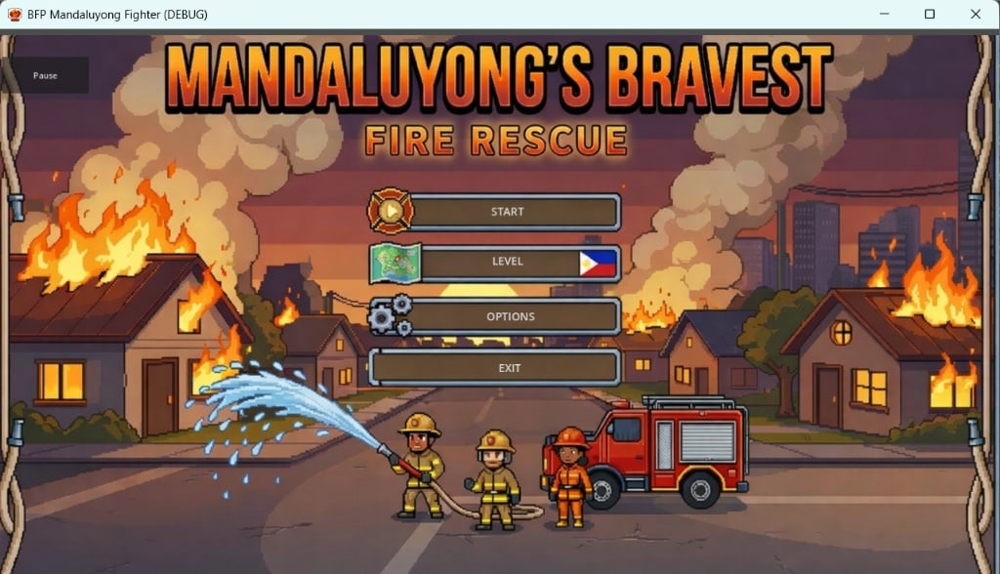
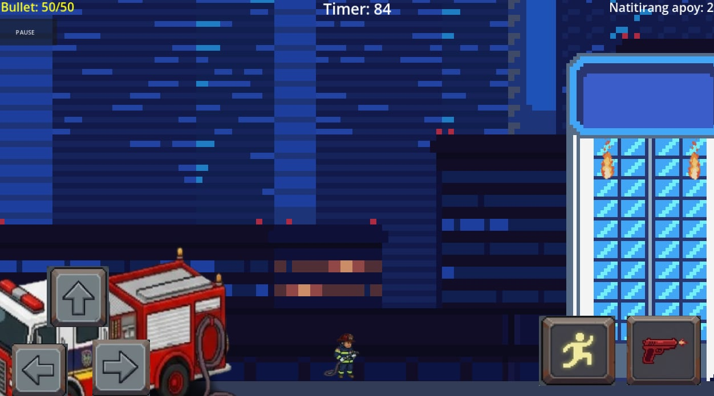
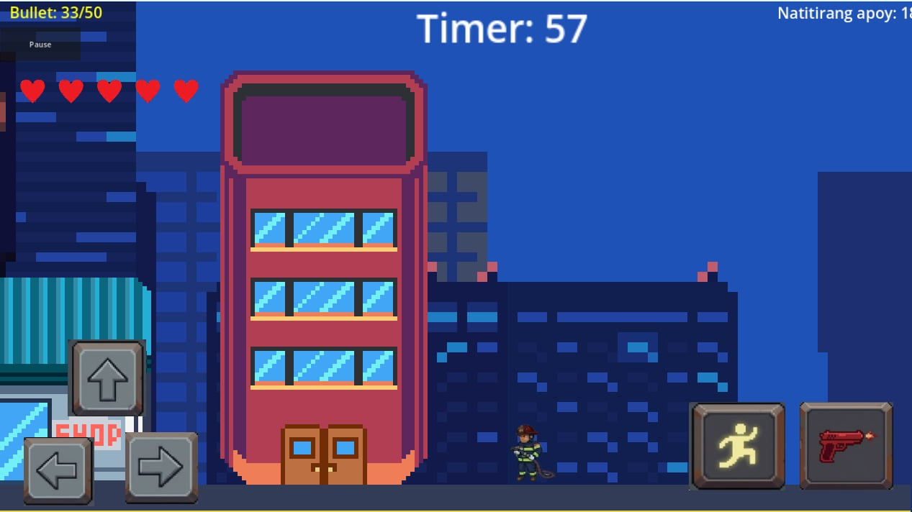
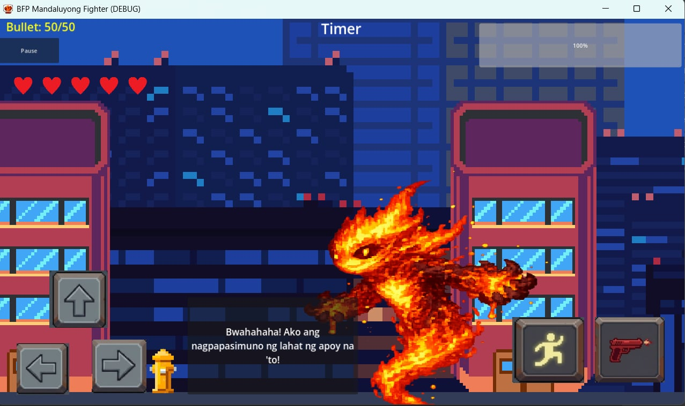

# Mandaluyong's Bravest: Fire Rescue

An interactive 2D action-educational simulation game developed using Godot Engine, designed to promote fire safety awareness through engaging firefighting gameplay mechanics.

## Game Overview

* **Engine:** Godot Engine (2D Physics & Tilemaps)
* **Language:** GDScript
* **Core Gameplay:** Control a firefighter responding to emergency calls, managing water supply ammo, working against the clock, extinguishing active fires, and taking down final boss hazards across multiple levels.
* **UI & Controls:** Custom touch D-Pad interface, dynamic ammo/water tracker, survival countdown timer, and objective tracking system.

---

## Game Previews

<div align="center">

### 1. Title Screen & Main Menu


### 2. Level 1 Gameplay


### 3. Level 2 Gameplay


### 4. Final Boss Encounter


</div>

---

## Key Features & Mechanics

* **Custom Player Physics:** Smooth movement, jump mechanics, and action-oriented controls.
* **Projectile Dynamics:** Water stream and hose mechanics for extinguishing fire targets.
* **Dynamic HUD:** Real-time water/bullet counter, timer countdown, and active fire tracking interface.
* **Level Progression & Boss Battles:** Tilemap-based level layout featuring escalating environmental hazards and animated fire boss encounters.

---

## Project Structure

```
.
.
├── project.godot          # Godot project file (open this in the editor)
├── gd.scripts/            # GDScript files: game logic
├── scenes/                # Game scenes (.tscn)
└── Assets-Fire-Rescue/    # Screenshots used in this README
```

## Run the Project

1. Install [Godot Engine](https://godotengine.org/download) (version 4.x; use the same version the project was built with, shown in the editor when you import it).
2. Clone this repository:
   ```
   git clone https://github.com/GeloLazo/mandaluyongs-bravest-fire-rescue.git
   ```
3. Open Godot, click **Import**, and select `project.godot`.
4. Press **F5** to run the game.

## Notes

* This repository shows the game's source code (GDScript and scenes). Art and audio assets are not included, so Godot may show missing-resource warnings when you open the project.
* The game is themed around the firefighters of Mandaluyong City and aims to teach fire safety awareness.

## Author

**Evan Gelo T. Lazo**: IT Graduate, José Rizal University (2026)
[github.com/GeloLazo](https://github.com/GeloLazo)
